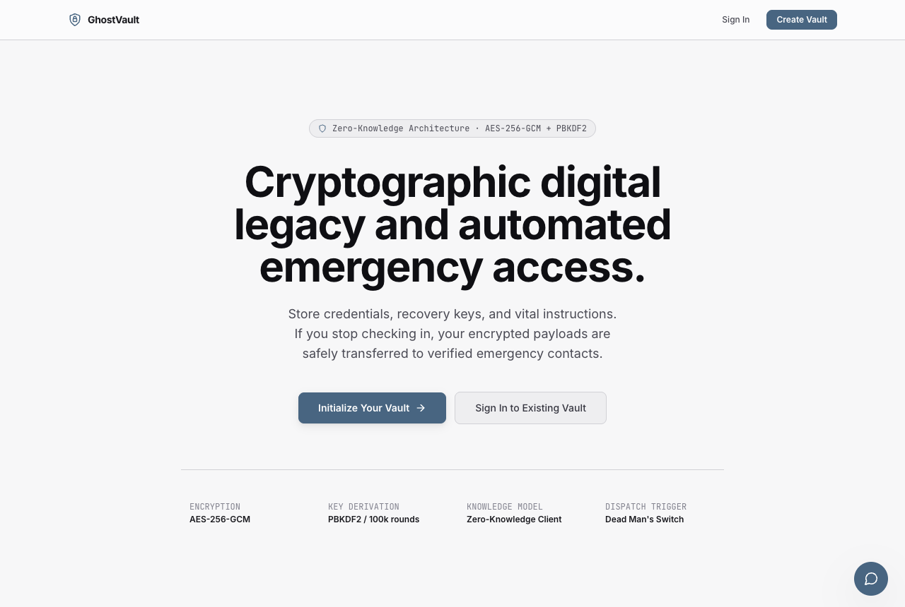
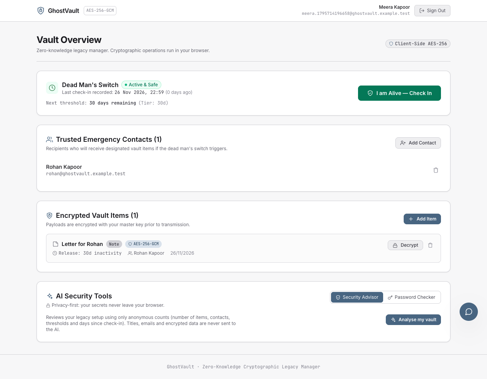
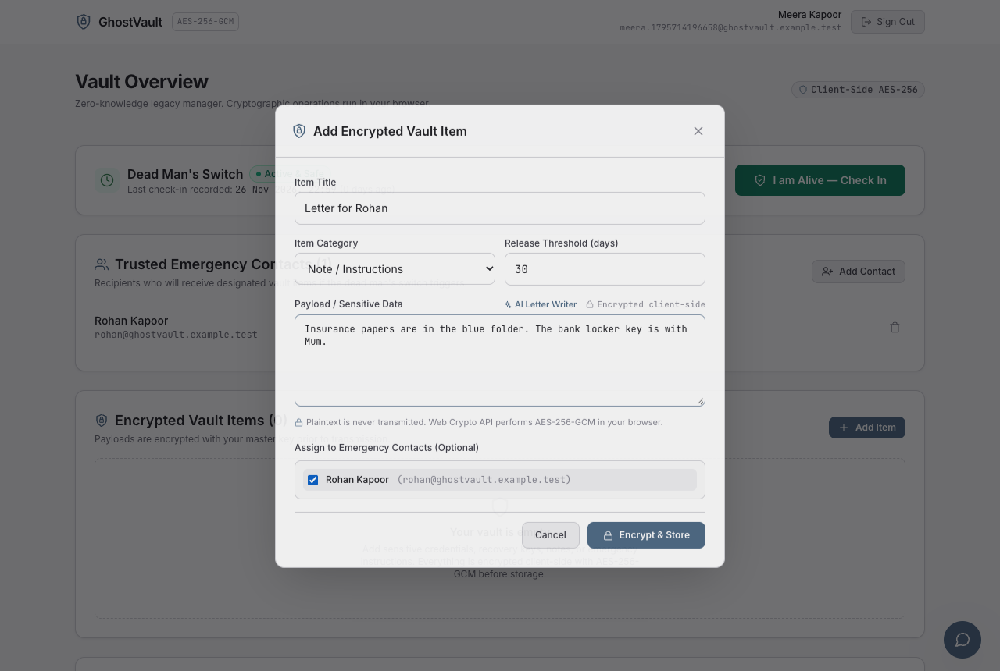

# GhostVault

An encrypted digital-legacy manager with a dead man's switch. You store passwords, notes and instructions, encrypted in your browser. If you stop checking in for a set number of days, the items you chose are released to your trusted contacts.

**Live demo:** <https://ghost-vault-lyart.vercel.app> (frontend on Vercel, API on Render's free tier, so the first request after an idle spell can take about 40 seconds).

| Landing page | Dashboard | Adding an encrypted item |
| --- | --- | --- |
|  |  |  |

Screenshots are from a local run with a test account.

## Features

- **Client-side encryption**: each vault item's content is encrypted in the browser with AES-256-GCM before it is sent. The key comes from your master password with PBKDF2 (SHA-256, 100,000 iterations, your email as the salt), and every item gets a fresh random 12-byte IV. The server stores the ciphertext and IV.
- **Dead man's switch**: every item has its own release threshold in days (for example passwords after 7 days, a letter after 30). The dashboard shows the days left until the shortest one runs out.
- **Check-ins**: an "I am Alive" button on the dashboard resets the timer and records a check-in.
- **Trusted contacts**: add contacts and choose which items each one receives.
- **Scheduled jobs** (node-cron, daily):
  - a reminder email when you are within 3 days of your shortest threshold;
  - a release run: for each item past its threshold, it creates a release per assigned contact and emails them a link. It never sends the same item twice.
- **Emergency access page** (`/emergency-access/<id>`): the contact opens the link and enters the master password you shared with them; the item is decrypted in their browser.
- **Email** with Nodemailer: Ethereal test inboxes in development, any SMTP server in production.

### AI features (Google Gemini, optional)

All AI calls are made by the server, so the Gemini key never reaches the browser. Without a key, every feature falls back to built-in offline answers.

| Feature | Where | What is sent to the AI |
|---|---|---|
| **Chat assistant ("Ghost")** | Chat bubble on every page | Only the chat messages (users are told not to paste secrets) |
| **Legacy letter writer** | Add Item → Note → AI Letter Writer | Only the rough notes the user chooses to send. The finished letter is encrypted in the browser like any other item |
| **Security advisor** | Dashboard → AI Security Tools | Only counts (items, contacts, thresholds, days since check-in), never titles, emails or ciphertext |
| **Password checker** | Dashboard → AI Security Tools | The password is analysed in the browser; only derived features (length, character classes, patterns) are sent for tips |

If the configured model is busy, the API retries with fallback models (`GEMINI_FALLBACK_MODELS`).

## Tech stack

| Part | Tools |
| --- | --- |
| Frontend | Next.js 16 (App Router), React 19, TypeScript, Tailwind CSS, Web Crypto API |
| Backend | Node.js 24, Express 4, Prisma 5, Zod, JWT, bcrypt, Helmet, express-rate-limit, node-cron, Nodemailer |
| Database | SQLite in development and tests, PostgreSQL in production |
| AI | Google Gemini REST API, server-side only |
| Tests and CI | Jest (39 tests in 6 suites), GitHub Actions |
| Hosting | Vercel (frontend), Render (API and PostgreSQL, `render.yaml`); Dockerfiles and `docker-compose.yml` for a single server |

## Architecture

```
Browser (Next.js)                                   Emergency contact's browser
  │  derive key: PBKDF2(master password, email)       │  enters the shared master password,
  │  encrypt item: AES-256-GCM                        │  decrypts the released item locally
  ▼                                                   ▼
Express API (JWT auth, Zod validation, rate limits) ◄─┘  GET /api/releases/:id
  ├── Prisma ──► SQLite (dev) / PostgreSQL (prod): users, items (ciphertext + IV), contacts, check-ins, releases
  ├── node-cron ──► daily reminder and release jobs ──► Nodemailer (SMTP)
  └── /api/ai/* ──► Google Gemini (optional, with offline fallbacks)
```

```
backend/
  src/routes/      auth, vault, contacts, checkin, releases, ai
  src/services/    vault, contacts, check-in and release logic, email, AI
  src/jobs/        node-cron scheduler
  src/middleware/  JWT auth and error handling
  prisma/          SQLite schema (dev); production/ holds the PostgreSQL schema and migrations
  tests/           Jest suites
frontend/
  app/             landing, login, signup, dashboard, emergency-access/[id]
  components/      check-in card, contacts, vault items, add-item dialog, AI tools, chat
  lib/             API client, Web Crypto helpers, local password analysis
shared/            shared types and encryption helpers
```

## Security

- **Passwords**: bcrypt with 12 rounds. Sign-up requires 8+ characters with upper case, lower case and a digit (Zod).
- **Tokens**: JWTs signed and verified with a pinned `HS256` algorithm. In production the API refuses to start if `JWT_SECRET` is missing or shorter than 32 characters.
- **Rate limits** per IP, per 15 minutes: 30 auth requests, 40 AI requests, 300 requests overall. `trust proxy` is on in production so limits apply to the real client IP behind Render's proxy.
- **Headers**: Helmet with a strict Content-Security-Policy on the API; `X-Frame-Options: DENY`, `nosniff`, `Referrer-Policy`, `Permissions-Policy` and HSTS on the frontend.
- **Errors**: one error handler hides stack traces and database details in production.
- **Secrets**: no keys in the repo. `docker-compose.yml` and `render.yaml` read them from the environment or the hosting dashboard.

### Known limitations

- The master password is also the login password, so it is sent to the server at sign-up and login (over HTTPS) and stored as a bcrypt hash. The server never stores item contents in plain text, but a compromised server could capture the password at login. A stricter zero-knowledge design would derive a separate login secret from the password so the server never sees it.
- Item titles, types and release settings are stored in plain text so the dashboard can list them; only the content is encrypted.
- During a session the master password is kept in the browser's `sessionStorage` so items can be encrypted and decrypted.
- An emergency contact can only decrypt a released item if you shared the master password (or a passphrase) with them in advance; the key hint you set at sign-up is shown to help.

## Run locally

You need Node.js 24 and npm.

```bash
npm install                      # installs the backend, frontend and shared workspaces

cd backend
cp .env.example .env             # SQLite and Ethereal test mail work out of the box
npx prisma db push               # creates the SQLite database and the Prisma client
cd ..

npm run dev:backend              # terminal 1: API on http://localhost:3001
npm run dev:frontend             # terminal 2: app on http://localhost:3000
```

The frontend calls `http://localhost:3001/api` unless `NEXT_PUBLIC_API_URL` is set (see `frontend/.env.example`). To turn on live AI, put a free Gemini key from <https://aistudio.google.com/apikey> in `backend/.env` as `GEMINI_API_KEY`. Never put it in the frontend or commit it.

## Tests

```bash
npm run test:backend
```

| Suite | What it checks |
| --- | --- |
| `auth.test.js` | bcrypt hashing (12 rounds, random salts), JWT creation and rejection of tampered tokens |
| `vault.test.js` | encrypted item CRUD; users can't read or delete each other's items |
| `checkin.test.js` | check-ins, inactivity calculation and switch status |
| `release.integration.test.js` | an inactive user's items are released once, and an active user's are not |
| `ai.test.js` | offline fallbacks, the Gemini key only in headers (never in URLs or logs), advisor scoring |
| `security.test.js` | only ciphertext is stored, bcrypt work factor, release pages don't expose password hashes |

GitHub Actions runs these tests and the frontend lint and production build on every push.

## API

| Area | Endpoints |
| --- | --- |
| Auth | `POST /api/auth/signup`, `POST /api/auth/login`, `GET /api/auth/me` |
| Vault items | `GET/POST /api/vault`, `GET/PATCH/DELETE /api/vault/:id` |
| Contacts | `GET/POST /api/contacts`, `GET/PATCH/DELETE /api/contacts/:id` |
| Check-in | `POST /api/checkin`, `GET /api/checkin/status` |
| Releases | `GET /api/releases/:id` (public link sent to the contact) |
| AI | `GET /api/ai/status`, `POST /api/ai/chat`, `POST /api/ai/letter`, `GET /api/ai/advisor`, `POST /api/ai/password-tips` |
| Health | `GET /health` |

## Deployment

The frontend is on Vercel and the API and PostgreSQL database are on Render, set up by [`render.yaml`](render.yaml). [DEPLOYMENT.md](DEPLOYMENT.md) has the steps, plus the Docker and `docker-compose.yml` option for a single server. On Render, set `GEMINI_API_KEY` as a secret environment variable; `GEMINI_MODEL` defaults to `gemini-3.1-flash-lite`.

## License

[MIT](LICENSE)
